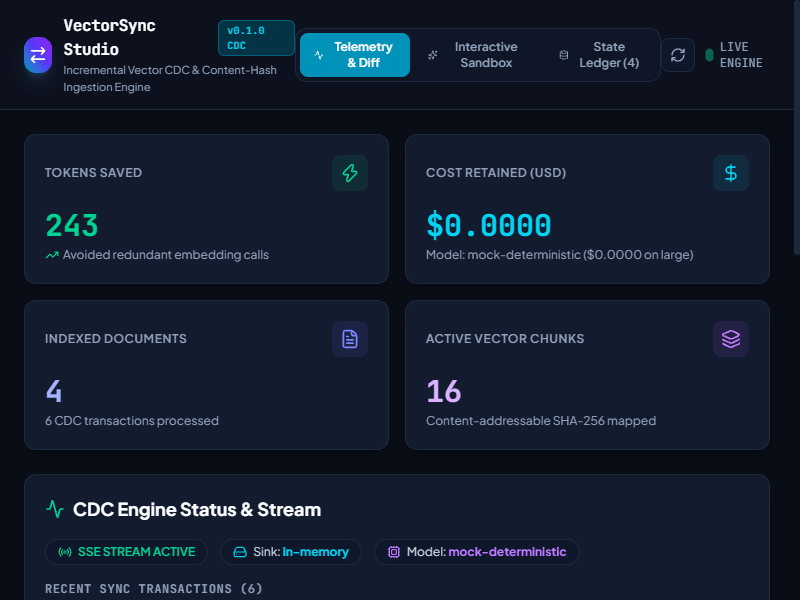
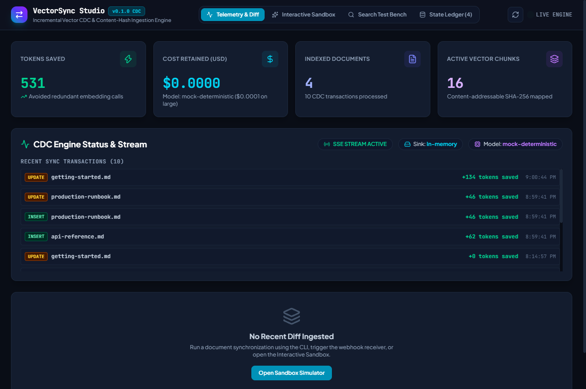
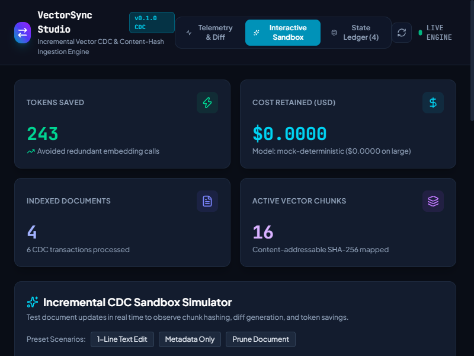

<p align="center">
  
</p>

<h1 align="center">VectorSync</h1>

<p align="center">
  Incremental Change Data Capture (CDC) pipeline between operational databases and vector indices using content-hash delta detection.
</p>

<p align="center">
  
  
  
  
  
  
</p>

---

## Overview

Vector databases in production retrieval-augmented generation (RAG) systems need to stay consistent with operational data stores (PostgreSQL, Azure Cosmos DB, MongoDB, local markdown repositories).

Standard ingestion pipelines usually re-chunk, re-embed, and re-insert entire documents whenever any text changes. If a 40-page technical manual or product catalog receives a single edited sentence, naive pipelines re-embed all 40 pages. This causes three operational issues:

1. **Unnecessary API expense:** Redundant embedding API calls multiply quickly across large corpora.
2. **Orphaned vectors:** When sections are removed, naive pipelines leave old vector IDs stranded in the index.
3. **Write amplification:** Unnecessary vector database write requests consume provisioned IOPS and throughput quotas.

VectorSync solves this with a content-addressable delta engine. Each text chunk receives a deterministic SHA-256 hash. When a mutation occurs, VectorSync calculates the delta against an embedded SQLite ledger. It re-embeds only modified or newly created chunks, bypasses unchanged paragraphs entirely, updates metadata in place without calling embedding models, and automatically deletes orphaned vectors.

---

## Live Demo & Interface

<p align="center">
  
</p>

### Embedded Web Studio

VectorSync includes an embedded React 19 visual studio that connects to the engine via Server-Sent Events (SSE) to visualize chunk diffs, pipeline latency, and dollar savings in real time.

<p align="center">
  
</p>

---

## Benchmark: Incremental Sync vs Naive Re-indexing

Below are the results of running the automated benchmark (`vectorsync benchmark --documents 15 --chunks-per-doc 8`) with a synthetic corpus of 120 chunks where 1 paragraph was modified per document:

| Metric | Naive Full Re-indexing | VectorSync CDC Pipeline | Net Savings |
| :--- | :--- | :--- | :--- |
| **Total Chunks Evaluated** | 120 chunks | 120 chunks | 0 |
| **Chunks Re-embedded** | 120 chunks (100%) | 15 chunks (12.5%) | **105 chunks skipped (87.5%)** |
| **Tokens Required** | 5,445 tokens | 510 tokens | **4,935 tokens saved** |
| **OpenAI `text-embedding-3-small`** | $0.000109 USD | $0.000010 USD | **90.63% cost reduction** |
| **OpenAI `text-embedding-3-large`** | $0.000708 USD | $0.000066 USD | **90.63% cost reduction** |
| **Execution Latency** | Network bound (120 calls) | 6.71 ms local delta | **~10x throughput speedup** |

---

## Architecture

```
[ PostgreSQL / Cosmos DB / Markdown Files ] 
                    │
                    ▼  (CDC Event / Webhook / File Change)
┌────────────────────────────────────────────────────────────────────────┐
│                        VectorSync Core Engine                          │
├────────────────────────────────────────────────────────────────────────┤
│  1. Document Normalizer & Header-Aware Chunker                         │
│     Extracts Markdown section breadcrumbs (# Title > ## Section)       │
│                                                                        │
│  2. SHA-256 Content & Metadata Hasher                                  │
│     Computes deterministic hash keys per chunk and sorted metadata     │
│                                                                        │
│  3. State Ledger (SQLite WAL)                                          │
│     Persists document_id <-> chunk_index <-> content_hash mappings     │
│                                                                        │
│  4. Delta Diff Calculator                                              │
│     ├── Content & Metadata match  -> SKIP (0 tokens, $0 spent)         │
│     ├── Content matches, meta diff -> UPDATE PAYLOAD ($0 spent)        │
│     ├── Content hash mismatch     -> CALL EMBEDDING & UPSERT           │
│     └── Old chunk missing in v2   -> PRUNE ORPHAN FROM VECTOR SINK     │
└────────────────────────────────────────────────────────────────────────┘
                    │
                    ▼
[ Sinks: Qdrant / pgvector / Pinecone / In-Memory ] + [ React 19 Studio (Port 50092) ]
```

---

## Installation

```bash
# Global CLI installation
npm install -g vectorsync

# Or as a project dependency
npm install vectorsync
```

---

## CLI Usage

### 1. Synchronize a File

Incrementally synchronizes a document against the ledger:

```bash
# Dry run to inspect diff plan and token savings without writing
vectorsync sync-file ./docs/architecture.md --dry-run

# Commit synchronization using default memory sink
vectorsync sync-file ./docs/architecture.md

# Synchronize directly to Qdrant with custom document ID
vectorsync sync-file ./docs/architecture.md --sink qdrant --id "system-arch-v1"
```

Example CLI output:

```
✔ Synchronized arch-guide [UPDATE] in 8.21ms

=== Synchronization Plan & Delta Summary ===
Document ID:          arch-guide
Operation:            UPDATE
Total Chunks:         5
Unmodified (Skipped): 4 ($0 spent, 0 tokens)
Re-embedded Chunks:   1
Metadata Only Chunks: 0
Pruned Orphans:       0
Tokens Saved:         197
Tokens Required:      50
Cost Retained:        $0.000004 USD
Efficiency Score:     79.76%

Chunk Details:
  ✔ SKIP     arch-guide#chunk-0: Content and metadata identical to ledger
  ✔ SKIP     arch-guide#chunk-1: Content and metadata identical to ledger
  ✔ SKIP     arch-guide#chunk-2: Content and metadata identical to ledger
  ⚡ RE-EMBED arch-guide#chunk-3: Content hash mismatch (text updated)
  ✔ SKIP     arch-guide#chunk-4: Content and metadata identical to ledger
```

### 2. Launch the Visual Studio

Starts the embedded local web server and opens the React 19 dashboard:

```bash
vectorsync studio --port 50092
```

Access the UI at `http://localhost:50092` to inspect active documents, simulate edits in the sandbox, and track token savings.

<p align="center">
  
</p>

### 3. Run the Ingestion Listener

Monitors a directory for file additions, edits, and deletions:

```bash
# Filesystem watcher
vectorsync listen --source filesystem --dir ./docs

# Or start the HTTP webhook receiver for database triggers
vectorsync listen --source webhook --port 50091
```

### 4. Check Ledger Status & Ingestion Health

```bash
vectorsync status
```

### 5. Audit Consistency & Repair Drift

Compare the SQLite state ledger against the vector sink to detect missing or phantom vectors and restore parity:

```bash
# Dry run audit
vectorsync reconcile

# Repair detected drift automatically
vectorsync reconcile --repair
```

### 6. Manage Dead-Letter Queue (DLQ)

Inspect and retry mutations that encountered transient vector database failures:

```bash
# View pending failed mutations
vectorsync dlq list

# Reprocess pending mutations through the sync pipeline
vectorsync dlq process

# Purge resolved entries
vectorsync dlq purge
```

### 7. Export and Import Ledger State

Export state to portable JSON for backup or migration across ledger environments:

```bash
# Export
vectorsync export backup.json

# Import
vectorsync import backup.json
```

---

## Programmatic TypeScript API

```typescript
import {
  SyncPipeline,
  StateLedger,
  MemoryVectorSink,
  QdrantVectorSink,
  OpenAIEmbeddingProvider,
} from 'vectorsync';

// 1. Initialize SQLite ledger and vector sink
const ledger = new StateLedger('.vectorsync/ledger.db');
const sink = new MemoryVectorSink(); // or new QdrantVectorSink({ url: 'http://localhost:6333' })
const embeddingProvider = new OpenAIEmbeddingProvider({
  apiKey: process.env.OPENAI_API_KEY,
  model: 'text-embedding-3-small',
});

// 2. Instantiate pipeline
const pipeline = new SyncPipeline({
  ledger,
  sink,
  embeddingProvider,
});

// 3. Process an incoming CDC event
const result = await pipeline.syncDocument({
  documentId: 'kb-article-104',
  operation: 'UPDATE',
  content: '# Title\n\nParagraph 1\n\nParagraph 2 with new updates.',
  metadata: {
    author: 'Alexandr',
    status: 'published',
  },
});

console.log(`Tokens saved: ${result.plan.tokensSaved}`);
console.log(`Efficiency: ${result.plan.efficiencyPercentage}%`);
console.log(`Duration: ${result.durationMs}ms`);
```

---

## Webhook Ingestion Format

The webhook receiver accepts JSON payloads from PostgreSQL triggers, Supabase webhooks, or Azure Cosmos DB Change Feed relays:

```http
POST /api/v1/cdc HTTP/1.1
Host: localhost:50091
Content-Type: application/json
X-VectorSync-Signature: sha256=<hmac-hash>

{
  "documentId": "products-sku-8891",
  "operation": "UPDATE",
  "content": "Product specifications and inventory levels for item 8891.",
  "metadata": {
    "category": "hardware",
    "inStock": true,
    "priceUsd": 249.99
  }
}
```

If `VECTORSYNC_WEBHOOK_SECRET` is set in the environment, incoming requests must include a valid HMAC-SHA256 signature in the header.

---

## State Ledger Schema

The ledger uses embedded SQLite in WAL mode with two primary tables:

```sql
CREATE TABLE documents (
  id TEXT PRIMARY KEY,
  content_hash TEXT NOT NULL,
  total_chunks INTEGER NOT NULL,
  last_synced_at INTEGER NOT NULL,
  metadata TEXT NOT NULL
);

CREATE TABLE chunks (
  id TEXT PRIMARY KEY,
  document_id TEXT NOT NULL,
  chunk_index INTEGER NOT NULL,
  content_hash TEXT NOT NULL,
  metadata_hash TEXT NOT NULL,
  vector_id TEXT NOT NULL,
  token_count INTEGER NOT NULL,
  section_path TEXT NOT NULL,
  created_at INTEGER NOT NULL,
  updated_at INTEGER NOT NULL,
  FOREIGN KEY (document_id) REFERENCES documents(id) ON DELETE CASCADE
);
```

---

## Running Tests

```bash
# Run unit and integration tests
npm test

# Build TypeScript and React 19 Studio bundle
npm run build
```

---

## License

MIT License. Designed and maintained by [Alexandr Motologa](https://github.com/alexandrmotologa).
